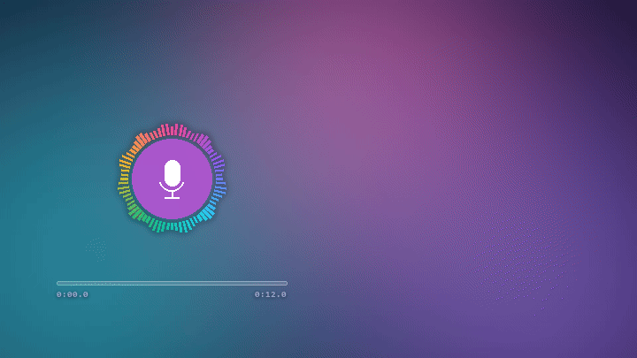
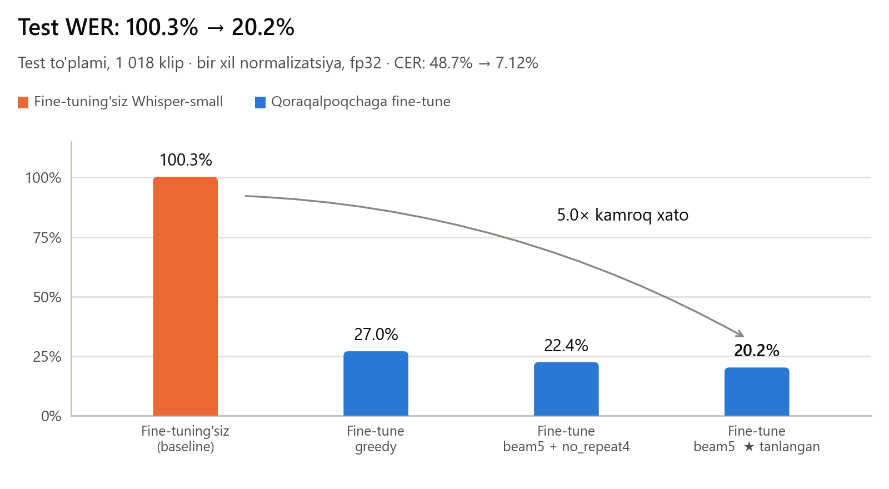
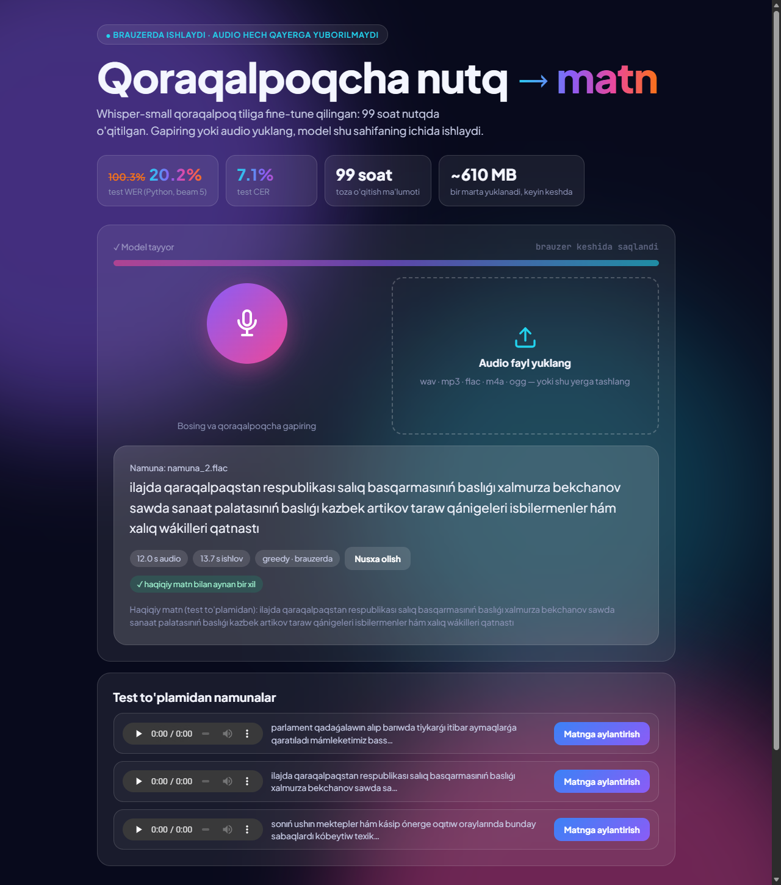
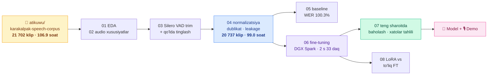
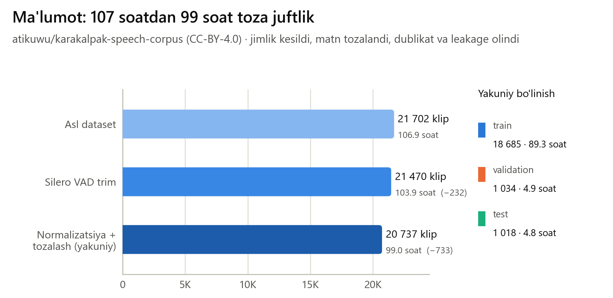
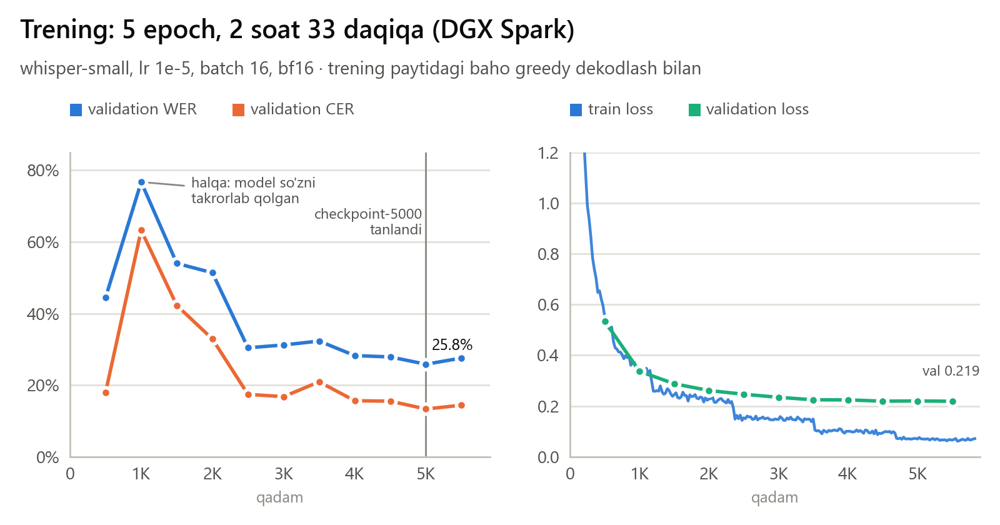
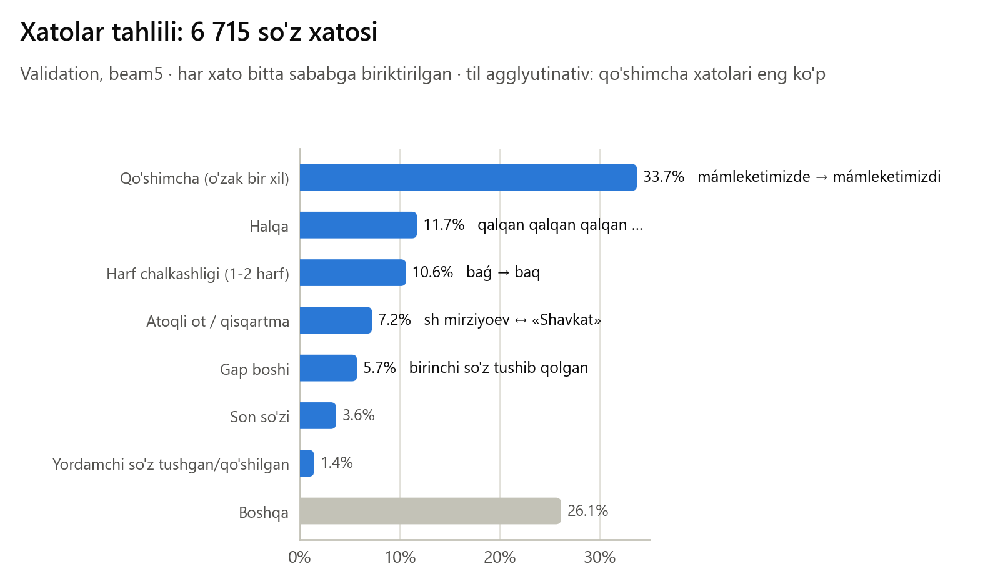
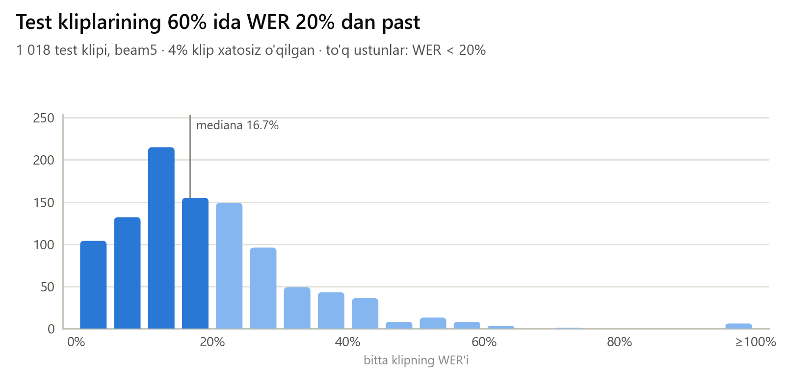
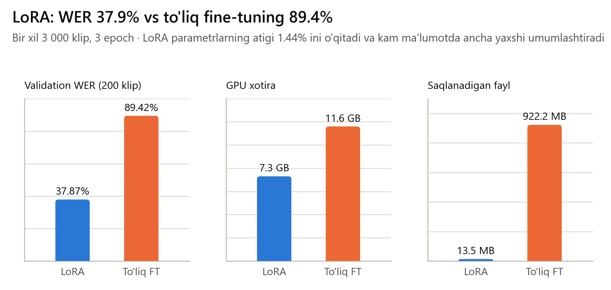

<div align="center">

# 🎙️ Whisper-small · Qoraqalpoq tili

**Qoraqalpoqcha nutqni matnga aylantiruvchi model.** OpenAI Whisper-small 99 soat qoraqalpoqcha nutqda fine-tune qilindi.
Ma'lumotni tozalashdan xatolar tahliligacha bo'lgan butun yo'l shu repoda: kod, natijalar va har bir raqamning manbasi.

[](https://huggingface.co/Toxirerkinovtohir/whisper-small-karakalpak)
[](https://toxirerkinovtohir-karakalpak-asr.static.hf.space/index.html)
[](assets/video_16x9.mp4)


[](LICENSE)



<sub>Test to'plamidagi audio → modelning haqiqiy chiqishi (bu klipda WER 0%).</sub>

</div>

---

## ✨ Asosiy natija

<picture>
  <source media="(prefers-color-scheme: dark)" srcset="assets/natija_dark.png">
  
</picture>

| Test to'plami (1 018 klip) | WER | CER |
|---|---:|---:|
| Fine-tuning'siz Whisper-small (`kk` → lotin) | 100.29% | 48.69% |
| Fine-tune, greedy | 27.04% | 13.35% |
| **Fine-tune, beam 5** ← asosiy natija | **20.22%** | **7.12%** |
| Fine-tune, beam 5 + halqa zaxirasi (`transcribe.py`) | 18.69% | 5.79% |

- **Dekodlash sozlamasi validation'da tanlangan, test to'plami faqat yakuniy baho uchun ishlatilgan.** Validation'da WER 20.07%, testda 20.22% chiqdi: raqamlar bir-biriga yaqin, demak natija ishonchli.
- Barcha variantlar **teng sharoitda** o'lchangan: bir xil fp32, bir xil normalizatsiya va bir xil reference ([`07_eval/eval_teng.py`](07_eval/eval_teng.py)).
- **Halqa zaxirasi.** Model ba'zan bitta so'zni takrorlab "halqa"ga tushadi. Shunday bo'lsa, bo'lak `no_repeat_ngram_size=3` bilan qayta o'qiladi. Test to'plamida bu faqat 6 ta klipga tegdi, lekin WER'ni 1.5 punkt tushirdi ([`07_eval/eval_halqa_zaxira.py`](07_eval/eval_halqa_zaxira.py)). Zaxira sozlamalari testda tanlanmagan.

🎬 **Video:** [16:9 (GitHub)](assets/video_16x9.mp4) · [4:5 (ijtimoiy tarmoq)](assets/video_4x5.mp4). Loyiha 54 soniyada; video ham kod bilan yasalgan: [`scripts/make_video.py`](scripts/make_video.py).

---

## 🚀 Sinab ko'rish

**1. Brauzerda, hech narsa o'rnatmasdan.** [**Demo sahifasi**](https://toxirerkinovtohir-karakalpak-asr.static.hf.space/index.html) ([HF Space](https://huggingface.co/spaces/Toxirerkinovtohir/karakalpak-asr)): mikrofonga gapiring yoki fayl yuklang. Model sizning brauzeringizda ishlaydi ([transformers.js](https://huggingface.co/docs/transformers.js), ONNX). Audio hech qayerga yuborilmaydi. Model ~610 MB, birinchi marta yuklanadi, keyin brauzer keshidan olinadi.

<div align="center"></div>

**2. Python, 3 qator.** Model Hugging Face'dan o'zi yuklanadi:

```python
from transformers import pipeline

asr = pipeline("automatic-speech-recognition", model="Toxirerkinovtohir/whisper-small-karakalpak")
print(asr("audio.wav", generate_kwargs={"language": "uz", "num_beams": 5})["text"])
```

**3. To'liq CLI.** Uzun audio, butun papka, CSV va halqa zaxirasi uchun:

```bash
git clone https://github.com/toxirerkinov70-commits/whisper-small-karakalpak
cd whisper-small-karakalpak
pip install -r requirements.txt

python transcribe.py examples/namuna_1.flac         # bitta fayl
python transcribe.py audiolar/ --csv natija.csv     # butun papka -> CSV
python transcribe.py uzun_intervyu.mp3 --greedy     # tezroq rejim
python app.py                                       # lokal Gradio demo: http://127.0.0.1:7860
```

> **Nega til tokeni `uz`?** Whisper'ning 99 tili ichida qoraqalpoq tili yo'q. Lotin yozuvidagi eng yaqin til
> tokeni `uz` bo'lgani uchun o'qitish ham, inference ham `language="uz"` bilan qilinadi.

30 soniyadan uzun audio pauzalardan bo'laklanadi: kesish joyi 20–30 soniya oralig'idagi eng jim nuqtada tanlanadi, shunda so'z o'rtasidan kesilmaydi.
CPU'da 10 soniyalik audio beam 5 bilan taxminan 20–27 soniyada, greedy bilan ~10 soniyada o'qiladi (oddiy noutbuk CPU'si, fp32). GPU'da bu 1 soniyadan kam.

---

## 🧭 Loyiha qanday qurilgan



Har bir papka bitta bosqich, raqami ishlash tartibini bildiradi:

| Papka | Nima qilinadi | Asosiy fayllar |
|---|---|---|
| [`01_EDA`](01_EDA) | Datasetni birinchi ko'rish: davomiylik, matn uzunligi, belgilar | `EDA.ipynb`, `dataset_summary.csv` |
| [`02_audio_features`](02_audio_features) | STFT → Mel → Fbank, Silero VAD, SNR | `audio_features_silero.ipynb` |
| [`03_trim`](03_trim) | Jimlikni kesish, shubhali kliplarni qo'lda tinglash | `clipping.ipynb`, `trim_utils.py` |
| [`04_normalize`](04_normalize) | Matn normalizatsiyasi → **asosiy manifest** | `normalize.py`, `manifest_tayyor.csv` |
| [`05_baseline`](05_baseline) | Fine-tuning'siz Whisper; 50 klipli qo'lda tekshirilgan "gold" to'plam | `whisper_baho.ipynb`, `gold_50.csv` |
| [`06_finetune`](06_finetune) | O'qitish, checkpoint tanlash, trening tarixi | `train_whisper.py`, `results/` |
| [`07_eval`](07_eval) | Teng sharoitda baholash, xatolar tahlili | `eval_teng.py`, [`xatolar_tahlili.md`](07_eval/xatolar_tahlili.md) |
| [`08_lora`](08_lora) | LoRA va to'liq fine-tuning taqqoslovi | `lora_vs_full.py`, `*_natija.json` |
| [`scripts`](scripts) | README grafiklari, video va ONNX eksport | `make_figures.py`, `make_video.py`, `export_onnx.py` |
| [`web`](web) | Brauzer demosi (transformers.js) va uning oxirigacha testi | `index.html`, `serve.py`, `e2e_test.mjs` |
| [`docs`](docs) | Bir sahifalik yakuniy xulosa | [`YAKUNIY_XULOSA.md`](docs/YAKUNIY_XULOSA.md) |

---

## 📦 Ma'lumot

<picture>
  <source media="(prefers-color-scheme: dark)" srcset="assets/malumot_dark.png">
  
</picture>

- **Manba:** [atikuwu/karakalpak-speech-corpus](https://huggingface.co/datasets/atikuwu/karakalpak-speech-corpus) (CC-BY-4.0): 21 702 audio, 48 kHz, mono.
- **Trim ([`03_trim`](03_trim)):** Silero VAD bilan boshi va oxiridagi jimlik kesildi, 200 ms zaxira qoldirildi. Kesish audioni 30% dan ko'proq qisqartirsa yoki matn uchun nutq juda tez chiqsa (>24 belgi/s), klip kesilmay qoldirildi. 148 ta shubhali klip qo'lda tinglandi ([`tinglash_royxati.csv`](03_trim/tinglash_royxati.csv)), jami 232 ta audio chiqarildi ([`chiqarilganlar.csv`](03_trim/chiqarilganlar.csv)).
- **Normalizatsiya ([`04_normalize/normalize.py`](04_normalize/normalize.py)):**
  - kichik harf, `I` → `ı` muammosi tuzatildi (`Issıxana` → `ıssıxana`);
  - rim raqami deb so'zga aylanib ketgan bosh harflar qaytarildi (`mıńınshı. Yusupova` → `M. Yusupova`);
  - `mln` → `million`;
  - matn oxiridagi `ÓzA` olib tashlandi: audioda aytilmaydi, 510 ta klipda bor edi.
- **Tozalash:** qavsli matnlar, 30 soniyadan uzunlar, split'lar orasidagi leakage va dublikatlar chiqarildi.
- **Gold to'plam:** 50 ta test klipi qo'lda tinglab tekshirildi. 37 tasi to'g'ri, 11 tasida audio muammosi, 2 tasida matn xatosi bor edi. Audio muammoli kliplarsiz WER ~2 punkt past chiqdi (19.50% → 17.39%): ma'lumot sifati model sifatining bir qismi.

---

## 🏋️ Fine-tuning

<picture>
  <source media="(prefers-color-scheme: dark)" srcset="assets/trening_dark.png">
  
</picture>

| | |
|---|---|
| Asos model | `openai/whisper-small` (244M parametr), to'liq fine-tuning |
| Giperparametrlar | lr 1e-5, warmup 500, batch 16, 5 epoch (5 840 qadam), bf16 |
| Uskuna | NVIDIA DGX Spark (GB10), 2 soat 33 daqiqa |
| Tanlangan checkpoint | `checkpoint-5000`: validation'da eng past WER |

**Grafikdagi sakrash haqida.** 1000-qadamda greedy WER 44% dan 77% ga sakradi. Bu modelning yomonlashgani emas edi.
Gipoteza tekshirildi: sakrashni bir nechta klipdagi **halqalar** keltirib chiqargan (model bir so'zni yuzlab marta yozgan), loss esa bir tekis pasayib borgan.
Saboq: *raqamga darrov ishonma, gipoteza → kichik tajriba → dalil*.

---

## 🔬 Xatolar tahlili

<picture>
  <source media="(prefers-color-scheme: dark)" srcset="assets/xatolar_dark.png">
  
</picture>

Validation'dagi har bir so'z xatosi bitta sababga biriktirildi ([`07_eval/xato_tahlili.py`](07_eval/xato_tahlili.py)). To'liq tahlil va misollar: [**xatolar_tahlili.md**](07_eval/xatolar_tahlili.md).

1. **Qo'shimchalar, 33.7%:** `mámleketimizde` → `mámleketimizdi`. Qoraqalpoq tili agglyutinativ: o'zak to'g'ri, qo'shimcha adashadi.
2. **Halqa, 11.7%:** bor-yo'g'i 10 ta klipdan chiqqan. Halqa zaxirasi aynan shuning uchun qo'shildi.
3. **Harf chalkashligi, 10.6%:** `ǵ ↔ q`, `á ↔ a`.
4. **Atoqli ot, 7.2%:** bir qismi reference muammosi (matnda `sh mirziyoev`, diktor esa "Shavkat" deb o'qigan).
5. **Gap boshi, 5.7%:** "trim nutq boshini kesgan" gipotezasi raqamlar bilan **rad etildi** (kesilgan kliplarda 31.0%, kesilmaganlarda 37.5%).

<picture>
  <source media="(prefers-color-scheme: dark)" srcset="assets/taqsimot_dark.png">
  
</picture>

---

## ⚖️ LoRA va to'liq fine-tuning

<picture>
  <source media="(prefers-color-scheme: dark)" srcset="assets/lora_dark.png">
  
</picture>

Bir xil 3 000 ta train klip, 3 epoch, 200 ta validation klip ([`08_lora/lora_vs_full.py`](08_lora/lora_vs_full.py)).
**Kam ma'lumotda LoRA ancha yaxshi umumlashtirdi:** parametrlarning 1.44% ini o'qitib, WER 37.9% ga erishdi. To'liq fine-tuning esa 89.4% bo'ldi va 33 ta klipda halqaga tushdi.
LoRA 7.3 GB xotira oladi va 13.5 MB fayl saqlaydi (to'liq FT: 11.6 GB va 922 MB).
*Cheklov:* ikki run'da learning rate har xil (1e-3 va 1e-5), to'liq ma'lumotda LoRA hali sinalmagan.

---

## 🌐 Brauzer demo qanday qurilgan

Model PyTorch'dan ONNX'ga o'girildi va [`web/index.html`](web/index.html) sahifasida `transformers.js` orqali ishga tushirildi. Yo'lda uchta tuzoq chiqdi, har biri o'lchab hal qilindi:

| Muammo | Sabab | Yechim |
|---|---|---|
| `Missing the following inputs: cache_position` | transformers ≥ 4.43 bilan eksport decoder'ga yangi kirish qo'shadi, transformers.js uni bermaydi | Eksport transformers 4.42 + optimum 1.21 muhitida ([`scripts/export_onnx.py`](scripts/export_onnx.py)) |
| 8-bit modelda sifat tushdi | Per-tensor 8-bit: 40 ta test klipida CER 8.84% → 15.60% | Encoder fp32 + decoder **4-bit blokli** (MatMulNBits): namunalarda PyTorch'ga deyarli aynan mos |
| 12 s audio **188 s** da o'qildi | Brauzer WASM'ni bitta oqimda ishlatgan | COOP/COEP sarlavhalari (`crossOriginIsolated`) → ko'p oqim: **13 s** |

Sahifa haqiqiy brauzerda oxirigacha sinaldi ([`web/e2e_test.mjs`](web/e2e_test.mjs), headless Edge): model yuklandi, namuna haqiqiy matn bilan aynan bir xil o'qildi, konsolda xato yo'q.
Lokal ishga tushirish: `python web/serve.py`, keyin `http://127.0.0.1:8000/web/`.

---

## 🔁 Natijalarni takrorlash

```bash
pip install -r requirements-train.txt
```

1. **Ma'lumot.** `01_EDA` va `02_audio_features` notebook'lari datasetni `hf_cache/` ga yuklaydi. `03_trim/clipping.ipynb` esa `DATASET_trimmed/` ni yaratadi (~6 GB, repoga kirmaydi).
2. **Manifest.** [`04_normalize/manifest_tayyor.csv`](04_normalize/manifest_tayyor.csv) repoda tayyor turibdi, ya'ni 1-qadamdagi tanlovlar aynan qayta tiklanadi.
3. **O'qitish (GPU):** `cd 06_finetune && python train_whisper.py`
4. **Baholash (GPU):** `cd 07_eval && python eval_teng.py`. Model sukut bo'yicha HF'dan olinadi; lokal checkpoint uchun `KAA_ASR_MODEL=yol/modelga` bering.
5. **CPU'da ishlaydigan tahlillar:** `gold50.py`, `oza_soni.py` va `xato_tahlili.py` repodagi CSV'larni **bayt-bayt bir xil** qayta chiqaradi (tekshirilgan).
6. **Grafik va video:** `python scripts/make_figures.py`, `python scripts/make_video.py`.

Testlar: `pip install -r requirements-dev.txt && pytest`. Ular normalizatsiya qoidalari, halqa detektori va uzun audioni bo'laklashni tekshiradi (21 ta test).

---

## 🚧 Cheklovlar va keyingi qadamlar

- Ma'lumot asosan **yangiliklar uslubidagi o'qilgan nutq**. Erkin suhbat, shevalar va shovqinda sifat pastroq bo'lishi kutiladi.
- Brauzer demosi `transformers.js` da **greedy** dekodlash bilan ishlaydi (decoder 4-bit), shuning uchun Python'dagi beam 5 dan biroz pastroq.
- Sonlar so'z bilan yoziladi (`eki mıń jigirma altınshı`), tinish belgisi va katta harf yo'q. Model normalizatsiya qilingan matn uslubida yozadi.
- **Keyingi qadamlar:**
  - qoraqalpoq matnidan til modeli qurib, LM fusion qilish (qo'shimcha xatolariga qarshi);
  - to'liq ma'lumotda LoRA;
  - w2v-BERT 2.0 + CTC bilan solishtirish;
  - sonlar va qisqartmalarni audioga mos normalizatsiya qilish.

---

## 📜 Litsenziya va minnatdorchilik

- **Kod:** [MIT](LICENSE).
- **Model:** Apache-2.0, asos model [openai/whisper-small](https://huggingface.co/openai/whisper-small) kabi.
- **Ma'lumot:** *Karakalpak Speech Corpus*, [atikuwu](https://huggingface.co/datasets/atikuwu/karakalpak-speech-corpus), **CC-BY-4.0**. `examples/` dagi 3 ta audio shu korpusning test to'plamidan olingan.
- Trening NVIDIA DGX Spark'da o'tkazildi.

<div align="center">

**Toxir Erkinov** · [GitHub](https://github.com/toxirerkinov70-commits) · [Hugging Face](https://huggingface.co/Toxirerkinovtohir)

⭐ Foydali bo'lsa, repoga yulduzcha qo'ying

</div>
